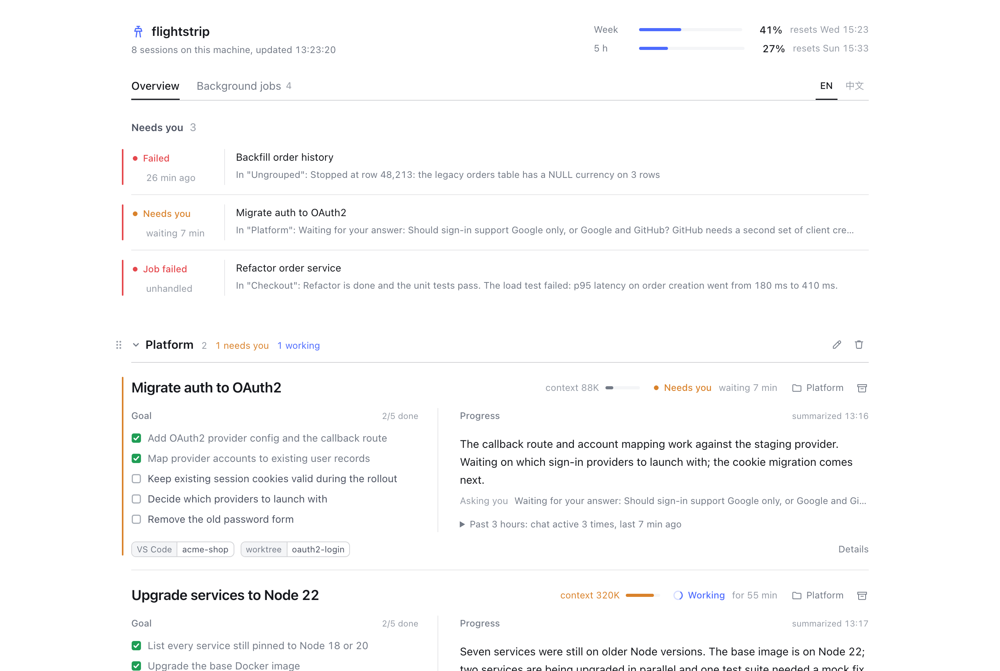
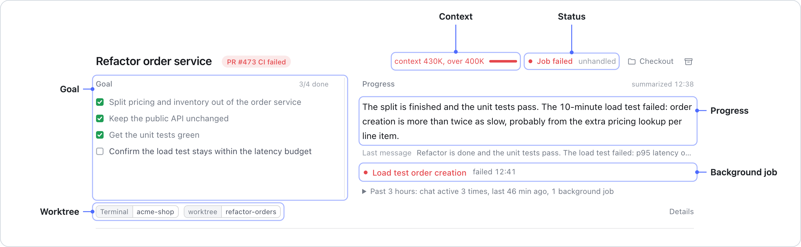
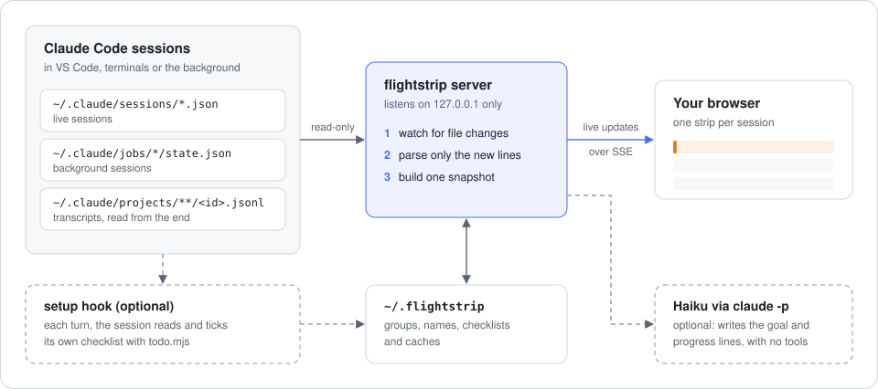

<div align="center">

# flightstrip

**One strip per Claude Code session: what it's trying to do, how far it got, and whether it needs you.**

[](https://www.npmjs.com/package/flightstrip)
[](LICENSE)


**[Try the live demo](https://wangxuzhou666-arch.github.io/flightstrip/)** · English · [中文](README.zh-CN.md)



</div>

```bash
npx flightstrip
```

Your browser opens on `http://127.0.0.1:4317`. Every Claude Code session on this machine shows up on its own, whether it runs in VS Code, a terminal or the background. Nothing to configure.

## Why

Run eight agents in parallel and the agents stop being the bottleneck. You are.

Each session has its own goal, its own half-finished step, a background job you forgot about and a worktree somewhere. The only way to find out is to open every window and scroll. Your context runs out long before theirs does.

Air traffic controllers handled this decades ago: one paper strip per flight, just enough to know what each plane is doing and which one needs you next. flightstrip does the same for coding agents. It doesn't show you everything. It shows you the least you need to steer.

## What's on a strip



- **Goal.** The 2–6 outcomes the session is working toward, ticked off as they land.
- **Progress.** One plain-language line on where it is now, instead of a log to scroll.
- **Needs you.** Sessions waiting on your answer, or with a failed job nobody picked up, rise to the top.
- **Context.** Current context size against a line you choose (400K by default). Amber at 75%, red past it.
- **Background jobs.** Commands a session started in the background: running, failed or finished, with the last line of output.
- **Worktrees and PRs.** Which git worktrees the session touched, and its pull request's CI status.

Group strips by project, name the groups yourself and drag them into the order you think in.

## Quick start

```bash
npx flightstrip           # start the board and open it
npx flightstrip --demo    # look around with sample sessions first
npx flightstrip setup     # optional: let each session keep its own goal checklist
```

`setup` adds one `UserPromptSubmit` hook to `~/.claude/settings.json` (after backing it up and asking you). Each turn, the hook reminds the session of its checklist, and the session ticks items off itself. Only the last 3 finished items stay listed (older ones are just counted), so a long session's list doesn't fill up. `setup` copies its scripts into `~/.flightstrip/bin/`, so run it again after upgrading flightstrip. `npx flightstrip uninstall` removes it.

To keep the board running in the background on macOS:

```bash
npm i -g flightstrip && flightstrip service install
```

## How it works



- flightstrip reads what Claude Code already writes to `~/.claude`: running sessions, background jobs, and the tail of each transcript, parsed incrementally. It doesn't call a model to know a session's state.
- The server listens on `127.0.0.1` only, and stops collecting when no browser tab is open.
- **Goal and progress lines** are written by Haiku through your own Claude Code login (`claude -p --model haiku`, no tools). Transcript text goes to the same provider the session already talks to, and nowhere else. A summary costs about $0.001, at most 90 calls an hour, and everything switches off if one call ever costs more than $0.02. Turn it off with `FLIGHTSTRIP_BRIEFS=off`; sessions that use the `setup` hook still show their own checklist.
- **What it writes.** Its own state goes in `~/.flightstrip`. Two actions touch Claude Code: renaming a session appends a title line to its transcript, the same thing `/rename` does, and retiring a running background session runs `claude stop`. The conversation is kept either way.

## Configuration

| Variable | Default | What it does |
| --- | --- | --- |
| `PORT` | `4317` | Port for the board |
| `FLIGHTSTRIP_CONTEXT_LINE` | `400000` | Where the context meter turns red |
| `FLIGHTSTRIP_BRIEFS` | `on` | `off` stops all Haiku summaries |
| `FLIGHTSTRIP_LANG` | system locale | `en` or `zh`; the toggle on the board overrides it |
| `FLIGHTSTRIP_STATE_DIR` | `~/.flightstrip` | Groups, names, checklists and caches |
| `CLAUDE_CONFIG_DIR` | `~/.claude` | Where Claude Code keeps its files |

## How it compares

- **[Claude-Code-Agent-Monitor](https://github.com/hoangsonww/Claude-Code-Agent-Monitor)** is a full control room: complete conversations, cost analytics, launching agents, several providers. Use it when you want to see everything. Use flightstrip when seeing everything is the problem.
- **[claude-squad](https://github.com/smtg-ai/claude-squad)** runs agents in tmux and worktrees and lets you switch between them. It manages the sessions it starts; flightstrip watches the ones you already have, wherever you started them.
- **[ccusage](https://github.com/ryoppippi/ccusage)** reports tokens and cost from local logs. It answers "what did this cost", flightstrip answers "where is this at". They work well together.
- **`claude agents`** is Claude Code's own session list. flightstrip adds the goal, progress, context and jobs on top of it.

## Requirements

- Node.js 20 or newer, and Claude Code.
- macOS. Linux should work but isn't tested yet.
- flightstrip reads files Claude Code writes for itself, not a public API. If an update changes them and a strip looks wrong, please [open an issue](https://github.com/wangxuzhou666-arch/flightstrip/issues).

## Make it yours

Want a different look, or something else on each strip? Fork it. The code is small and every color is one variable.

```bash
git clone https://github.com/wangxuzhou666-arch/flightstrip
cd flightstrip && npm install
npm run dev:demo    # sample sessions with hot reload on http://127.0.0.1:5317
```

[CONTRIBUTING.md](CONTRIBUTING.md) maps each part of the board to the file that draws it. Pull requests and issues are welcome.

## License

MIT
