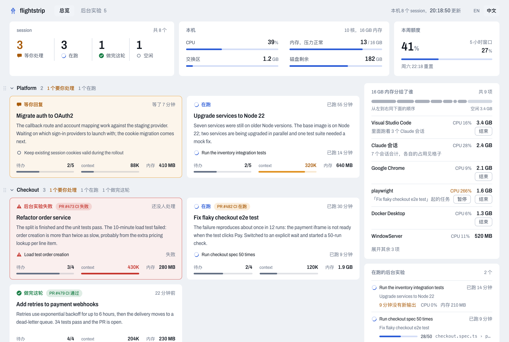
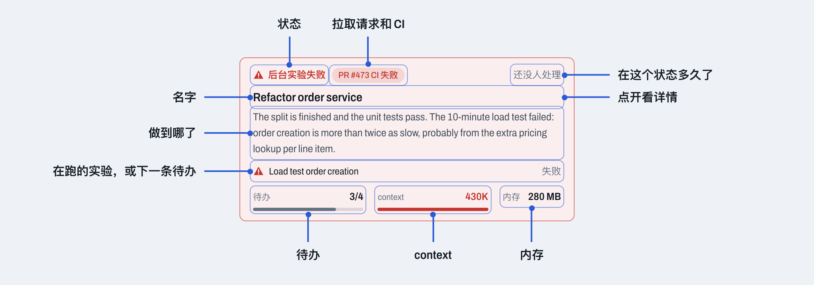
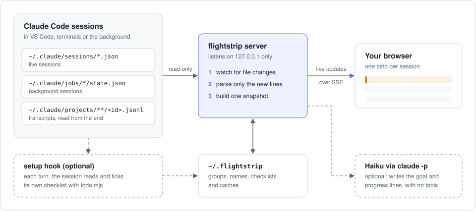

<div align="center">

# flightstrip

**每个 Claude Code session 一张纸条：它要做成什么、做到哪了、要不要你出手。**

[](https://www.npmjs.com/package/flightstrip)
[](LICENSE)


**[在线试用演示](https://wangxuzhou666-arch.github.io/flightstrip/)** · [English](README.md) · 中文



</div>

```bash
npx flightstrip
```

浏览器会打开 `http://127.0.0.1:4317`。这台机器上所有的 Claude Code session 都会自己出现，不管是在 VS Code、终端里还是在后台跑。不用任何配置。

## 为什么做这个

同时开八个 agent，瓶颈就不在 agent 了，在你自己。

每个 session 都有自己的目标、做到一半的步骤、一个你早忘了的后台任务，还有藏在某处的 worktree。想知道它们的状态，只能一个个窗口点开往上翻。你的上下文比它们的先用完。

塔台管制员几十年前就解决了这个问题：每架飞机一张进程单（flight strip），上面只写够用的信息：这架飞机在干嘛、下一个该处理谁。flightstrip 给 coding agent 做的是同一件事。它不把所有东西都摆给你看，只给你统筹调度需要的最少信息。

## 一张纸条上有什么



每个 session 是一个格子，格子一样高，一整面墙扫一眼就能看完：

- **目标**：这个 session 要达成的 2 到 6 件事，做完一件勾一件。格子上写做了几件、下一件是什么。
- **进展**：一句大白话说清现在做到哪了，不用去翻日志。
- **要你处理**：在等你回答的 session，或者后台任务失败了没人管的，在组里排第一。顶上的读数带会数出有几个，点数字直接打开第一个。
- **Context**：当前 context 有多大，对照你定的一条线（默认 400K）。到 75% 变琥珀色，过线变红。
- **内存**：这个 session 连同它起的所有进程（MCP、shell、后台任务）占了多少内存。
- **后台任务**：session 放到后台跑的命令，在跑、失败还是跑完，附最后一行输出。在跑的任务如果输出里有 `[3/8]`、`45%`、`epoch 4/20` 这类步骤，会显示进度条；还会显示它的进程占了多少 CPU 和内存，5 分钟没有新输出会注明，如果 CPU 也几乎不动就用琥珀色提醒。
- **Worktree 和 PR**：这个 session 碰过哪些 git worktree，它的 PR 的 CI 状态。

点一个格子，详情从右边滑出来：完整的清单、所有在跑的任务、过去 3 小时和最近动态，改名、换组、退役也在这里。左边的格子一直看得见。

格子可以按项目分组，组名自己起，拖动组头按你习惯的顺序排。

顶上的读数带按状态数 session，并在本周额度旁边显示这台机器的 CPU、内存、交换区和磁盘剩余。

## 内存分给了谁

八个 session 加上它们的 MCP、测试和训练任务，很容易在你没注意时把笔记本的内存吃满。看板右栏显示内存去了哪：一根按应用和任务分段的条，下面是占得最多的几项，和活动监视器同口径（含被压缩和挪到交换区的部分）。

- session 起的大任务单独一行，写着是哪个 session 起的。**暂停**让它先停住，进度不丢，它就不再抢内存；**继续**接着跑。**结束**让它自己退出，8 秒后还没退就给「强制结束」。
- 应用可以结束；结束一个装着 session 的应用（VS Code、终端）时，会说清要带走几个。系统进程和 flightstrip 自己没有按钮。
- flightstrip 不会自己去暂停或结束任何进程。macOS 报内存吃紧时，面板标出建议先处理的那一项，flightstrip 暂停自己的 Haiku 调用直到缓过来；持续一分钟还会发一条通知，写明谁占得最多。

## 快速开始

```bash
npx flightstrip           # 启动看板并打开
npx flightstrip --demo    # 先用示例 session 看看效果
npx flightstrip setup     # 可选：让每个 session 自己维护目标清单
```

`setup` 会往 `~/.claude/settings.json` 加一个 `UserPromptSubmit` hook，加之前先备份并征求你同意。之后每一轮对话，hook 都会提醒 session 它的清单，session 做完一项自己勾掉。已完成的只列最近 3 条，更早的只计个数，长 session 的清单不会越积越长。`setup` 会把脚本复制到 `~/.flightstrip/bin/`，所以升级 flightstrip 后要再运行一次。`npx flightstrip uninstall` 可以移除。

想让看板在 macOS 后台常驻：

```bash
npm i -g flightstrip && flightstrip service install
```

## 原理



- flightstrip 只读 Claude Code 本来就会写进 `~/.claude` 的文件：在跑的 session、后台任务，以及每份对话记录的末尾，增量解析。判断一个 session 的状态不需要调用模型。
- 服务只监听 `127.0.0.1`，没有浏览器标签页打开时就停止采集。只有内存告警一直在跑：每 30 秒读两个 `sysctl`。
- **目标和进展**由 Haiku 写，走你自己的 Claude Code 登录（`claude -p --model haiku`，不给任何工具）。对话内容只会发给这个 session 本来就在用的同一家模型服务，不会发到别处。每条总结大约 0.001 美元，每小时最多 90 次；只要有一次调用超过 0.02 美元，就整个停掉。用 `FLIGHTSTRIP_BRIEFS=off` 可以关闭；装了 `setup` hook 的 session 仍然显示它自己写的清单。
- **会写什么**：自己的数据放在 `~/.flightstrip`。只有两个操作会碰到 Claude Code：给 session 改名，会在它的对话记录末尾追加一行标题，和 `/rename` 做的一样；退役一个正在跑的后台 session，会执行 `claude stop`。两种情况对话都会保留。在内存排行里暂停、继续或结束一项，会给它的进程发信号（`SIGSTOP`、`SIGCONT`、`SIGTERM`，只有点「强制结束」才发 `SIGKILL`）。

## 配置

| 变量 | 默认值 | 作用 |
| --- | --- | --- |
| `PORT` | `4317` | 看板端口 |
| `FLIGHTSTRIP_CONTEXT_LINE` | `400000` | context 用量过这条线变红 |
| `FLIGHTSTRIP_BRIEFS` | `on` | 设为 `off` 关闭所有 Haiku 总结 |
| `FLIGHTSTRIP_ALERTS` | `on` | 设为 `off` 关闭内存吃紧时的系统通知 |
| `FLIGHTSTRIP_LANG` | 跟随系统语言 | `en` 或 `zh`；看板上的切换按钮优先 |
| `FLIGHTSTRIP_STATE_DIR` | `~/.flightstrip` | 分组、名字、清单和缓存 |
| `CLAUDE_CONFIG_DIR` | `~/.claude` | Claude Code 存文件的位置 |

## 和同类工具的区别

- **[Claude-Code-Agent-Monitor](https://github.com/hoangsonww/Claude-Code-Agent-Monitor)** 是一个完整的控制室：完整对话、费用分析、启动 agent、支持多家工具。想看到所有东西时用它；当「所有东西都看到」本身成了问题，用 flightstrip。
- **[claude-squad](https://github.com/smtg-ai/claude-squad)** 在 tmux 和 worktree 里跑多个 agent，方便你在它们之间切换。它管理的是它自己启动的 session；flightstrip 看的是你已经开着的 session，不管在哪开的。
- **[ccusage](https://github.com/ryoppippi/ccusage)** 从本地记录统计 token 和费用。它回答「花了多少」，flightstrip 回答「做到哪了」，两个可以一起用。
- **`claude agents`** 是 Claude Code 自带的 session 列表。flightstrip 在它之上加了目标、进展、context 和后台任务。

## 环境要求

- Node.js 20 或更新版本，以及 Claude Code。
- macOS。Linux 应该能用，但还没测过。
- flightstrip 读的是 Claude Code 写给自己用的文件，不是公开 API。如果某次升级后纸条显示不对，请[提 issue](https://github.com/wangxuzhou666-arch/flightstrip/issues)。

## 改成你想要的样子

想换个样式，或者让纸条显示别的信息？直接 fork。代码不多，每种颜色都是一个变量。

```bash
git clone https://github.com/wangxuzhou666-arch/flightstrip
cd flightstrip && npm install
npm run dev:demo    # 用示例 session 启动，带热更新，地址 http://127.0.0.1:5317
```

[CONTRIBUTING.md](CONTRIBUTING.md)（英文）列出了看板上每一块对应哪个文件。欢迎提 PR 和 issue。

## 许可证

MIT
